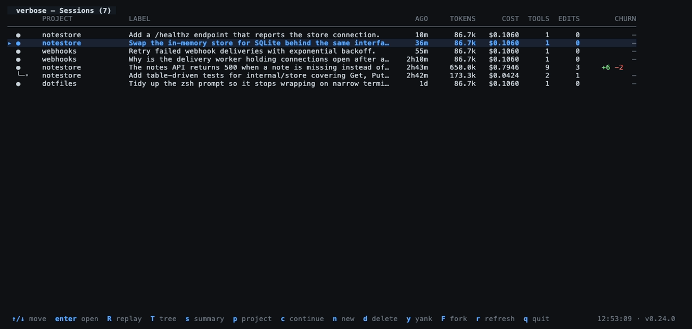
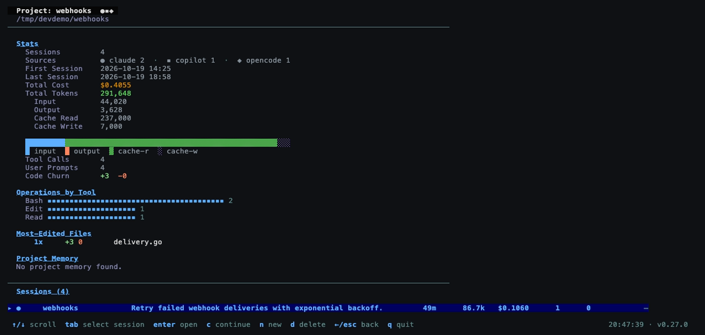
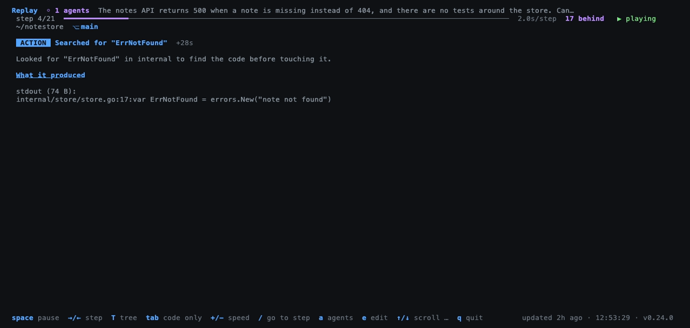
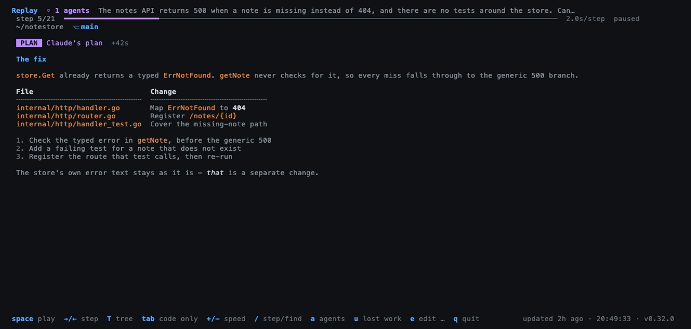
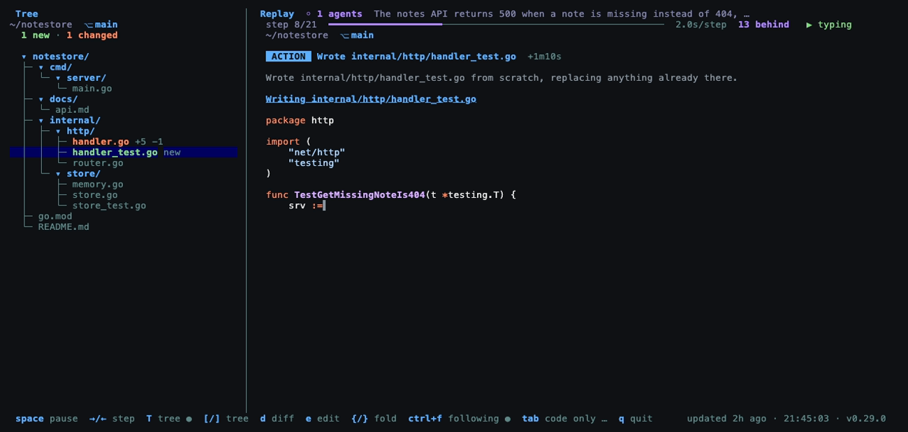
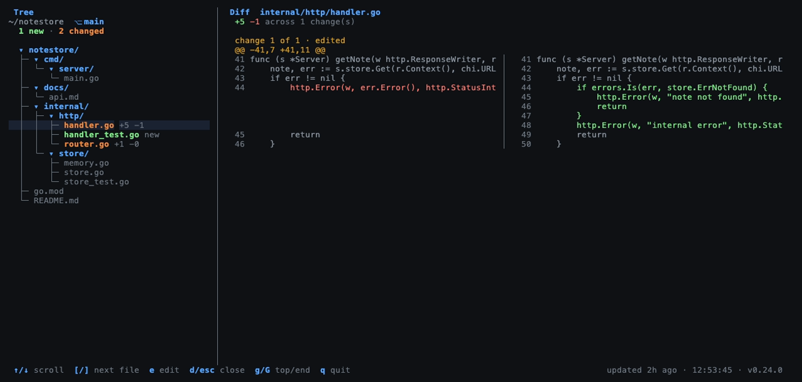
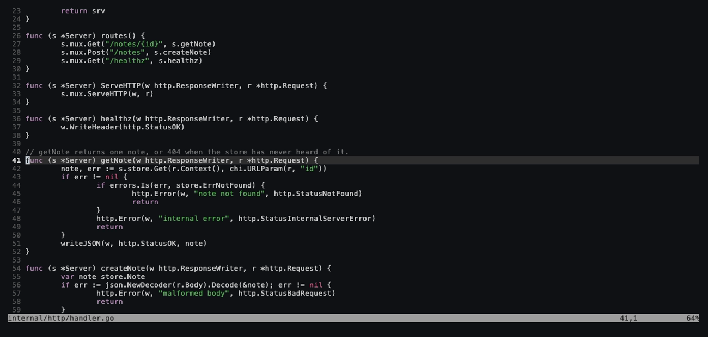
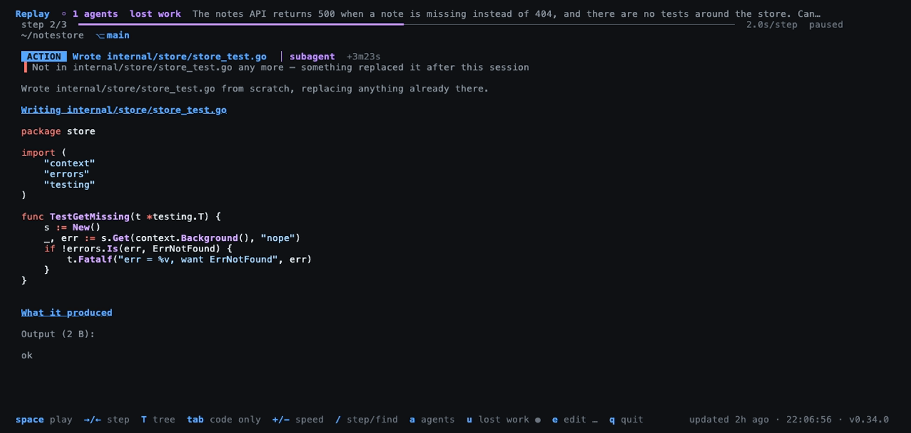
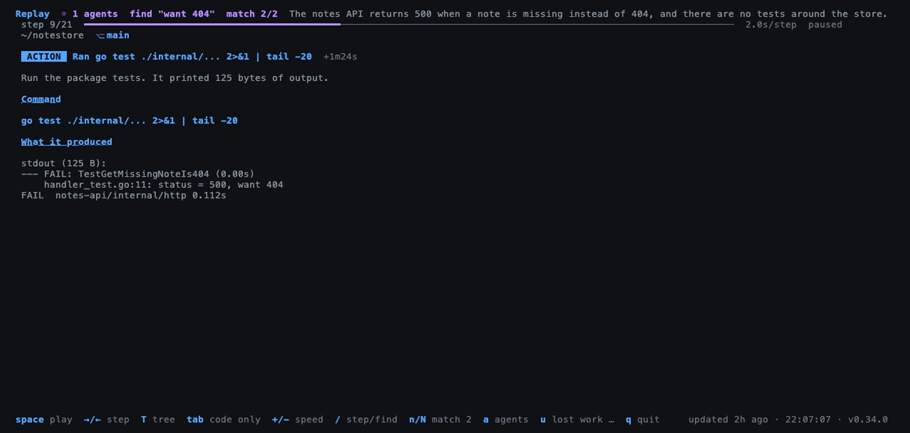
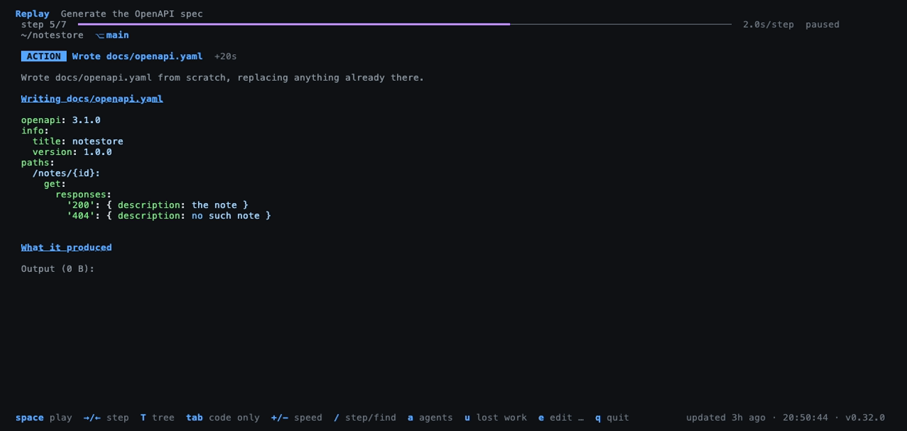

# verbose

[](https://github.com/fooxytv/verbose/actions/workflows/ci.yml)
[](https://github.com/fooxytv/verbose/actions/workflows/release.yml)
[](https://github.com/fooxytv/verbose/releases/latest)
[](go.mod)
[](https://pkg.go.dev/github.com/fooxytv/verbose/pkg/session)
[](LICENSE)

A terminal UI for browsing and analyzing [Claude Code](https://docs.anthropic.com/en/docs/claude-code),
[Codex](https://developers.openai.com/codex/cli),
[GitHub Copilot CLI](https://docs.github.com/copilot/concepts/agents/about-copilot-cli),
[OpenCode](https://opencode.ai) and [pi](https://github.com/badlogic/pi-mono)
session transcripts.

Verbose reads the session data these agents store locally and presents it in a single
interactive, color-coded viewer with real-time updates — and hands any of them
back to its own CLI to carry on.


<sub>Recorded against a synthetic session — see
[docs/demo.tape](docs/demo.tape).</sub>

## Features

- Browse Claude Code, Codex, Copilot, OpenCode and pi sessions across projects, side by side
- Subagent runs appear inline in their parent's timeline, at the call that
  launched them — and separately, so you can see what one run cost
- Sessions are listed by what they are about, not by ID — the title Codex,
  Copilot and OpenCode each generate, or the opening prompt for Claude Code
  and pi
- `c` resumes any of them in the right CLI: `claude --resume`,
  `codex resume`, `copilot --resume`, `opencode --session`, `pi --session`
- A project is a directory, so the project view says which agents worked in it
- Event timeline with color-coded entries (prompts, tool calls, thinking, results)
- Detailed event drill-down with diff highlighting for file edits
- Session summary with token usage breakdown and activity stats
- Cost reconstructed per model from published rates, rather than one flat rate
- Replay a session one step at a time, at reading speed, to follow work that
  originally scrolled past in seconds
- `u` in a replay shows only the work that did **not** last — the steps whose
  code is no longer in the files, which is otherwise invisible unless you
  remember it existed
- `/` in a replay finds a step by what it ran, wrote or printed — a long
  session is too long to step through, and the output is the only place an
  outcome lives
- `verbose find "docker run"` answers the same question from a prompt, across
  every session, and says which step and which line
- `--redact` masks tokens, keys and assigned passwords in every view, for
  reading a session where someone else can see it
- A replay opens where you are: on the step the timeline cursor points at, or
  on the search hit you followed into the session
- Live auto-follow mode — watch sessions update in real time
- Mouse scroll support
- Filter by project name
- Open any file in your own editor (`e`) at the line the session changed — no IDE required
- Resume any session in a new tmux pane or terminal tab, with the right CLI for its source
- Delete sessions from the machine, with a confirmation step

## Finding something again

```console
$ verbose find -project powerbi "docker run"
4 hits for "docker run" in 2 of 8 sessions

2026-10-20 13:40  claude  powerbi-fabric-workspace-lifecycle  87709cfb-…
    step 605/1218  Ran NET=$(docker network ls --format '{{.Name}}' | head -1)
        command: docker run --rm --network "$NET" mcr.microsoft.com/azure-cli:latest \
```

The question usually arrives at a prompt rather than in an application, and
the answer is a session, a step number and the line it was on — so `R` and
`/` take you back to watching it. `-project` narrows, `-limit` bounds, `-json`
makes it machine-readable, and nothing matching exits 0 with a sentence saying
how much was searched.

Note the headline on that hit: `Ran NET=$(docker network ls …)`. The `docker
run` is on the **second line** of the command, so no amount of reading step
titles would have found it. One step in five on this machine runs a multi-line
command.

## Reading a session where someone can see it

`verbose --redact` masks what looks like a credential — GitHub, GitLab and
Slack tokens, Azure account keys and SAS signatures, AWS key ids, JWTs,
private key blocks, and a password or secret assigned a literal value. The
footer says `redacted` for as long as it is on, on the left where the
keybindings are, because both halves of that row give way on a narrow terminal
and an indicator that disappears is worse than none.

**It is a display control, not a security control.** Everything in a
transcript has already been through a model, so masking the local copy cannot
un-send it. What it stops is the *second* audience: a screen share, a
screenshot in a channel, a `-json` dump pasted into a ticket. **If a secret
reached a transcript, rotate it** — and remember the plaintext copy lives in
`~/.claude/projects` until Claude Code's `cleanupPeriodDays` removes it, and
is copied by every backup in the meantime.

It is deliberately shy. A reference to a secret is not a secret, so
`client_secret = $ARM_CLIENT_SECRET`, `var.client_secret`,
`${{ secrets.AZURE_CLIENT_ID }}`, `os.Getenv("API_KEY")` and
`password = "<your-password>"` are all left alone — on a terraform or Actions
transcript that is most of them, and masking them would destroy the only
useful fact on the line while protecting nothing. Every pattern is anchored to
a word boundary for the same reason: an unanchored `sk-` matched 255 times
across one real history and every hit was the word `task-`.

Paths are never masked: a redacted path breaks the tree, the relinks and the
lost-work survey, and a directory name is not a credential.

## What it looks like

**Every session across every project**, by what it is about rather than by id,
whichever agent wrote it: `●` Claude Code, `✦` Codex, `◈` OpenCode, `▪`
Copilot, `▴` pi, and `◦` a subagent run. A subagent sits **under the session that
spawned it**, joined by `├─` and `└─`, so one piece of work reads as one block
instead of rows scattered by timestamp.



**Search every session, not just the titles** (`/`). The list shows what a
session was about; it cannot show what was *in* it, and most of a history is
older than the week you remember. A search reaches prompts, replies, file
paths and commands, says which of those matched each row, and carries the
query into the timeline so the session opens on the hit — and `R` from there
starts the replay on that step rather than at the beginning. There is no
index — scanning 18,000 events takes 12ms, well inside a frame.

**A project is a directory**, and more than one agent can work in it — so the
project view (`p`) marks which ones did, and counts the sessions each
contributed.



**Replay** (`R`) plays a session back at reading speed, typing the code out as
it was written, syntax highlighted. Under the progress bar sits the directory
the work happened in and the branch it was on — `~/workspace/proj  ⎇ main`.



**A plan is rendered, not flattened.** An agent writes markdown, so a `PLAN`
step gets its heading, its table, its numbered list and its `code` and **bold**
laid out — rather than every newline deleted and the whole thing run together
into one paragraph.



**The tree** (`T`) sits beside it and scrolls itself to whatever is being
changed — new files green, changed orange, removed red, untouched dim.



**Diffs** (`d`) open side by side for the file under the cursor, pairing each
removed line against the one that replaced it.



**Your editor** (`e`) opens the selected file at the line that changed, in
whatever `$EDITOR` you already use — here nvim on `handler.go:41`, the hunk the
session had just applied.



**What did not last** (`u`) narrows the replay to the steps whose work is no
longer in the files — three of twenty-one here, one of them written by a
subagent. The line under each headline names the file and says which it is:
something replaced the work, or the file itself is gone.



**Find a step by what it printed** (`/`). The same prompt as "go to step" — a
number jumps, anything else searches — and `n`/`N` move between the matches.
Here `want 404` is in two of the session's twenty-one steps: the test that
asserts it, and the run where it failed. **That failure text exists nowhere but
the step's output**, which is the half of a session no headline can show: one
step in five on this machine ran a command too long to fit on one line.



**Every source replays the same way.** This is a Codex thread, which records a
new file as content rather than as a diff — so the replay types the whole
document out, and the tree beside it counts the file as new.



Each row keeps its **own** cost, tokens and churn — a parent is not a total of
its children. Summing the column still counts every run exactly once, which is
what the project view relies on.

A subagent whose parent is not in the list — filtered to another project, or
its transcript deleted — stays where it is rather than being hidden, because it
still carries its own cost and its own work.

## Requirements

At least one of:

- **Claude Code** — session transcripts are read from `~/.claude/projects/`
- **Codex** — threads are read from the two SQLite databases under
  `~/.codex` (`$CODEX_HOME` if set): `state_N.sqlite` for the metadata,
  `thread_history_N.sqlite` for the content
- **GitHub Copilot CLI** — sessions are read from `~/.copilot`:
  `session-store.db` for the metadata, `session-state/<id>/events.jsonl` for
  the conversation
- **pi** — one JSONL file per session under `~/.pi/agent/sessions/`
- **OpenCode** — sessions are read from its database, normally
  `~/.local/share/opencode/opencode.db`

## Install

### Download a release (recommended)

Grab the latest pre-built binary for your platform from the
[Releases page](https://github.com/fooxytv/verbose/releases).

Unzip it and move the binary somewhere on your PATH:

**macOS / Linux:**
```bash
sudo mv verbose /usr/local/bin/
```

**Windows:** move `verbose.exe` to a directory on your PATH, or add its location to your PATH.

### With `go install`

Requires Go 1.25+ (the version in `go.mod`).

```bash
go install github.com/fooxytv/verbose@latest
```

**`go install` does not put the binary on your PATH.** It writes to `$GOBIN`, or
`$(go env GOPATH)/bin` when that is unset — usually `~/go/bin`, which macOS and
most Linux distributions do not search. The command succeeds and `verbose` is
still "command not found". Add it once:

```bash
# zsh (the macOS default)
echo 'export PATH="$(go env GOPATH)/bin:$PATH"' >> ~/.zshrc && source ~/.zshrc

# bash
echo 'export PATH="$(go env GOPATH)/bin:$PATH"' >> ~/.bashrc && source ~/.bashrc
```

Check it with `go env GOPATH` and `ls $(go env GOPATH)/bin`: if `verbose` is
there, this is all that was missing.

### From source

Requires Go 1.25+.

```bash
git clone https://github.com/fooxytv/verbose.git
cd verbose
go build -o verbose .
```

## Usage

```bash
# View all sessions
verbose

# Filter to a specific project
verbose -project myapp
verbose -project /path/to/project

# Point at a store in a non-standard location
verbose -opencode /path/to/opencode.db
verbose -codex /path/to/codex-home
verbose -copilot /path/to/copilot-home
verbose -pi /path/to/pi-home
```

### JSON output

`-json` answers one query on stdout and exits, so other tools can use what
verbose parses without reimplementing the reader:

```bash
verbose -json projects                  # every project, with spend and model mix
verbose -json sessions                  # every session, newest first
verbose -json sessions -project myapp   # just one project's
verbose -json sessions -limit 20        # cap the list
verbose -json session <id>              # one session's detail and todos
verbose -json session -events <id>      # ...including its event timeline
```

Each session carries a `source` (`claude`, `codex`, `copilot`, `opencode` or
`pi`)
and a `costBasis` saying where its cost came from: `recorded` for OpenCode and
Copilot, which both store real spend, `estimated` for Claude Code, which stores
only tokens, and `none` for Codex, which stores neither a cost nor a token
breakdown to derive one from. `totalTokens` is always filled: the breakdown
summed, or the single number Codex reports. A subagent run also carries
`isAgent`, its `agentType`, and the `parentSessionId` it belongs to.

A project carries `sources`, every tool whose sessions are in that directory.

In the session list Claude Code sessions are marked `●`, Codex `✦`, OpenCode
`◈`, Copilot `▪` and pi `▴`.

## Keybindings

| Key | Action |
|-----|--------|
| `j` / `Down` | Move down |
| `k` / `Up` | Move up |
| `Enter` / `Right` / `Space` | Open session / expand event |
| `Esc` / `Left` | Go back |
| `g` / `Home` | Jump to top |
| `G` / `End` | Jump to bottom |
| `PgUp` / `PgDn` | Page up / down |
| `/` | Search **every** session — prompts, replies, files and commands, not just titles |
| `d` | Delete session (asks to confirm) |
| `s` | Toggle session summary |
| `R` | Replay the session step by step, from wherever the cursor is |
| `T` | Project tree, marked with what the session changed (works inside a replay too) |
| `f` | Toggle auto-follow (timeline view) |
| `r` | Refresh session list |
| `q` / `Ctrl+C` | Quit |

In the replay view:

| Key | Action |
|-----|--------|
| `Space` | Play / pause — a pause holds the line you stopped on, and play carries on from there |
| `Right` | Finish typing this step, or move to the next |
| `Left` | Previous step |
| `Up` / `Down` | Scroll — takes manual control and pauses |
| `+` / `-` | Faster / slower (0.5s to 15s per step) |
| `/` | Go to a step by number, or find one — type `24` or `connection refused` |
| `n` / `N` | Next / previous match (`n` steps forward when nothing is being searched) |
| `a` / `A` | Switch to the next / previous subagent of this run, without leaving the replay |
| `Tab` | Code only — just the steps that wrote something |
| `u` | Lost work only — just the steps whose work is no longer in the files |
| `f` | Follow a running session (on by default) |
| `0` | Back to the first step |
| `t` | Jump to this point in the timeline |
| `↑`/`↓`, `j`/`k` | Move the tree selection (full-screen tree) |
| `]` / `[` | Move the tree selection (with the sidebar open) |
| `}` / `{` | Open / close a directory in the sidebar |
| `d` | Open the selected file's diff (`d` or `Esc` closes) |
| `e` | Open the selected file in `$EDITOR`, at the line that changed |
| `E` | The same, but beside verbose — a tmux pane or a new tab |
| `c` | Continue the session: see its last output and reply |
| `Ctrl`+`f` | Hand the tree's follow back to the replay |
| `Esc` | Back |

Mouse scroll works in every view. With the tree beside the replay, the pointer
decides which pane moves: over the tree it moves the selection, over the code it
scrolls the step.

The footer's right-hand side shows how long ago the open session was written,
the time now, and the version — so a live session visibly ticking apart from
one that stopped four minutes ago. On a narrow terminal both halves give way
gracefully: keybindings drop from the least useful end (never `q`), and the
status drops the version before the clock and the clock before the session age.

## Replay

Agents work faster than anyone can read. Replay gives one operation the whole
screen — what it did, in plain English, and the real evidence underneath: the
diff hunks Claude Code recorded, the command and what it actually printed.
Press `R` on any session, then `Space` to let it run.

**Code is typed out, not pasted in.** While playing, a diff is written a
character at a time at about 100 a second, with the viewport following the
cursor so the code arrives in front of you rather than off-screen. `+` and `-`
change the whole pace, typing and holds together. Command output is never
typed — a diff is worth following keystroke by keystroke, nine kilobytes of log
output is not.

Pausing or scrolling hands control back to you and reveals the whole step at
once, because stopping to look means you want to read it, not watch it. Play
carries on from the character it stopped at, not from the top of the step.

**The replay starts where you are.** `R` opens on the step the timeline cursor
is pointing at, so a search hit you followed into a session, or a row you
scrolled to, is the step the replay begins on rather than something to fast
forward to. Leaving a replay with `Esc` or `t` leaves that cursor on the step
that was showing, which is what makes pausing to look at something safe:
coming back with `R` carries on from there instead of starting the session
again. Opening a session and pressing `R` straight away still starts at step 1
— the cursor is tracking the end of a possibly-live transcript then, not
pointing at anything — and `0` is always the way back to the beginning.

### Reading a plan

A `PLAN` step is the agent's own prose, and an agent writes markdown. Across one
machine's 2327 assistant text blocks, 53% carry inline code, 34% bold, 17% a
heading, 15% a fenced code block, 11% bullets and 10% a table — and a third of
them are more than one line.

Those blocks are **rendered**: headings in colour, bullets and numbered lists
with their text hanging under themselves, tables in aligned columns, fenced code
syntax highlighted the same way a diff is, and `code`, **bold** and *emphasis*
shown as themselves rather than as asterisks and backticks.

Before this they were flattened. Every newline was deleted, so a heading, the
list under it and a table all ran together into one unbroken paragraph.

Markdown's own rules apply: lines broken in the source are re-flowed into one
paragraph, so a plan wraps to your terminal rather than to the width the agent
happened to write it at. Shell text is left alone — `rm *.go *.md`,
`snake_case_names` and `2*3*4` are not emphasis, and a plan that reads like a
command is still one you can retype.

### Searching a replay

Sessions get long — the replays here reach four figures of steps — and stepping
to the operation you remember is scrolling, not reading. `/` takes a needle as
well as a step number: type `24` to go to step 24, or type anything that is not
a number to find it. `n` and `N` move between the matches, wrapping at both
ends, and the header says which match is on screen.

**It searches more than the step shows.** A headline is a sentence verbose
wrote — "Ran go test ./..." — but what a reader remembers is the command, the
file, or what the command *printed*, and the output is the only place an
outcome lives. So the needle is matched against the step's headline and
explanation, the code it wrote, the file it touched, the prompt or reply behind
it, the command, its output, and the error string a failed shell command leaves
instead of a result. Searching `connection refused` or `exit code 127` finds
the step that failed.

A search that matches nothing leaves the replay where it is and says so,
rather than clearing the search that was working. Digits are always a step
number, which is the one thing the prompt cannot do both of — the number is by
far the likelier intent.

### Finding the code

Most of what an agent does is not writing code. Across one machine's
transcripts there were 2592 shell commands against 549 edits, so the steps that
actually produced something are easily buried. **`Tab` narrows the replay to
the steps that wrote code** — a recorded diff, a new file, or a shell heredoc —
and the header says `code only` while it is on.

Verbose looks for that code in three places, because a diff alone finds very
little of it:

| Where the code is | When |
|---|---|
| `structuredPatch` | An `Edit` to a file that already existed |
| `bashEditDiff` | A **shell command** that changed files — a real diff, one per file, since one command can change several |
| The `Write` tool's `content` input | A **new** file — Claude Code records an *empty* patch, since there is no "before" |
| A shell heredoc body | A shell write that recorded no diff |

On one session those last two rows took the visible-code steps from 1 to 173.
Machine-wide, from 6.4% of steps to 21.3%.

`bashEditDiff` is the one most easily missed: a shell command **does** record a
real diff, in a different field from the edit tools. Reading it took the steps
carrying a usable diff from 411 to 746 — more recorded diffs came from the shell
than from `Edit` and `Write` together.

A heredoc piped to an interpreter (`python3 - <<'PY'`) is shown as code but
labelled without a filename, because it writes no file — it is the script that
did the editing, not the result.

Streamed code is **syntax highlighted**, with the language taken from the
filename, or analysed from the content when a heredoc has no target. The colour
depth matches the terminal: truecolor where there is truecolor, 256 colours
otherwise. Highlighted files are cached, so a step costs about a millisecond to
re-render regardless of size.

### Did the work survive?

A transcript records an intent at a moment. Nothing in it says whether the code
it put in a file is still there, so an old replay shows every step as equally
alive: an edit that is still load-bearing reads exactly like one a later
session quietly replaced.

Press `u` to see only the steps whose work is gone. The header says `lost work`,
and each step carries a line naming what it lost:

```
▐ Not in internal/ui/replay.go any more — something replaced it after this session
▐ Not on disk any more — environments/dev.tfvars is gone, so this work is too
```

The unit of comparison is a **block** — one contiguous run of added lines —
because that is what either survived or did not. A whole hunk is the wrong
unit: two runs separated by a context line are two separate pieces of work.

Four rules keep the answer worth trusting, and each of them was measured
against one machine's history rather than guessed at:

| Rule | Why |
|---|---|
| A majority of a block's lines still present counts as **surviving**, in changed form | A later edit to one line inside a ten-line block has not undone the block. Lines are compared without their indentation, so moving code into a loop is not a loss either |
| Work the session itself changed again afterwards is **not** lost | An agent that edits one file eight times would otherwise report seven losses every time. 809 of 4202 blocks fall here |
| Work outside the project directory is **not checked** | 140 of 235 files holding "lost" work were scratchpads, `/tmp` and `/dev`. A temp file is *meant* to vanish, and flagging it buries the ones in the project |
| A project directory that is gone checks **nothing** | A removed or renamed folder is one fact about the session, not a loss in every step of it — and a rename is what [`verbose relink`](#after-renaming-or-moving-a-folder) is for |

What is left is sharp: across 10,385 steps on the machine this was built on,
94 steps in 12 of 28 sessions had work that is no longer in the files.

Pressing `u` with nothing to show says so and leaves the list alone, rather
than opening an empty screen. "Nothing was checked" and "nothing was lost" are
different answers, and it does not give the second when the first is true.

The comparison reads the files, so it happens when you press the key — never
while drawing a frame. It takes about 140ms on the longest session here, and
it is a snapshot: nothing watches the files afterwards.

### Subagents in a replay

A parent's replay **already contains** its subagents' turns, spliced in at the
call that launched them and marked `│ subagent`. On one real session that was
270 of 347 steps, and 193 of the 194 steps that touched a file — the agents did
nearly all the work.

What a parent's timeline cannot show is each run as its own thing: its own
cost, its own tokens, its own step numbers. **`a` swaps which session the
replay is playing** — parent, each agent in turn, back to the parent — without
leaving the view. `A` goes the other way. The header says which you are on
(`◦ 1 of 2 · scout`), and coming back returns you to the step you left rather
than to the beginning.

The tree follows the swap, so it marks the files that session touched rather
than keeping the previous one's.

### Following a live session

Replay follows a session that is still being written, and so does the tree: when
the transcript grows its steps are rebuilt and the tree re-reads both the
session's activity and the project directory, so a file the agent has just
created appears. The step count updates on
its own as the transcript grows — `300/300` becomes `300/312` without any
keypress — and when playback reaches the last recorded step it holds, `◴ live`,
then plays the new ones as they arrive. It reads at human speed while the agent works
at its own, so it falls behind; the gap is shown as `N behind` rather than
skipped. `f` turns following off.

It keeps the steps that carry the narrative — prompts, the agent's own
"here's what I'll do next", and every operation — and drops the bookkeeping
(hook progress, turn timings, bash keepalives). Subagent steps are marked, so
you can see where work was handed off and follow what the agent did with it.

If you want this *live* — an agent typing into your real editor while you
steer, which a transcript viewer cannot do — see
[AI Pair](https://github.com/faiface/ai-pair), a VS Code extension that gives
your existing agent a second cursor over MCP.

One honest limitation: **a replay can tell you what happened, not why.**
Extended thinking is signed but never written to the transcript, so every
thinking block on disk has an empty body. What a step shows is derived from
what was recorded — files, line counts, exit behaviour — and the agent's own
narration where it exists. Generated explanations are a separate layer, not
yet built.

### Where the work happened

Both the replay and the tree carry a line with the session's directory and git
branch. Every transcript records both; neither was on screen while reading one.

Long paths give up their **middle**, not their end — `~/…/team-skills-matrix-poc`
— because the last segment is the project and the first says which checkout,
and those are what tell two clones of the same repository apart. A long branch
gives up its front for the same reason: `…dev-mdevops-pool` says more than
`feature/allow-jf…`. Nothing is shortened while it all fits.

A session with no recorded branch shows none, and a detached checkout says
`detached` rather than printing `HEAD` as though it were a branch name.

## Tree

`T` works from the sessions list, the timeline and from inside a replay. It
shows the project as a tree, marked with what the open session did to each
file: **new** files in green, **changed** in orange with their churn, **removed**
in red, everything the session never touched dimmed. A change flashes as the
replay reaches it and then keeps its colour, so the tree accumulates a record of
the session rather than settling back to neutral. `Tab` narrows it to just the
files that changed. `Enter` on a file jumps the replay to the change.

Two different kinds of truth sit in that one view, and the header says so:

- **The structure comes from disk**, so it is the project as it is *now*. For a
  session from three weeks ago that is today's shape with three-week-old marks
  painted on. Files the session touched that have since gone are grafted back in
  and marked `(gone)`.
- **The marks come from the transcript**, which is exact however old the session
  is.

The tree follows the replay, and **scrolls itself to whatever is being worked
on** — a project tree is far longer than the pane showing it, so without
that the file being written is usually below the fold and its flash is never
seen. It stays on the most recent change rather than snapping back between
steps, and ignores changes with no row in the tree, such as scratch files a
session writes outside its own project.

`Space` plays, and files light up as they are written, settling over about a
second into their colour — so the project assembles itself in front of you.
Step back in the replay and later work disappears again. Moving the cursor
yourself takes over from the follow; `Space` hands it back. The sidebar has no
cursor of its own, so it always follows.

### Diffs

With a file selected in the tree, **`d` opens its diff** in the right-hand
pane — old on the left, new on the right, with line numbers, pairing each
removed line against the one that replaced it. `[` and `]` step to the next
file and the diff follows, so a run of changes can be read without closing it.
`d` or `Esc` closes it, and so does any replay control — `Space` closes the
panel and plays on, `←`/`→` close it and step — since reaching for those means
you are done reading.

Opening a diff pauses playback: reading a diff and watching code stream are not
things anyone does at once, and the pane the diff needs is the one the replay
was using. Two columns need **86 columns of pane**; below that it falls back to
a unified single column and says so.

Like the tree's colours, the diff is bounded by where the replay has reached —
it shows what had happened by that point, not what is still to come. For a file
whose changes come later it says so and tells you how many.

Not every change can be shown as a diff, and the panel says which reason
applies rather than appearing to have found nothing:

| Change | What the panel shows |
|---|---|
| An edit to an existing file | The recorded diff, side by side |
| A **new** file | All of it as additions — there is no previous version |
| Written through the shell | Its recorded diff where there is one, otherwise the whole body it was given |
| **Removed** | An explanation only. Claude Code has no delete tool, so the removal is inferred from the command line and the contents were never kept |
| Changed by **you**, outside Claude | The snippet the transcript keeps, which is all it keeps |

### Side by side

`T` inside a replay puts the tree **beside** the code rather than instead of it:
the tree on the left, the code streaming on the right, the tree lighting up as
each file is written. All keys stay with the replay and the tree follows, so
there is no focus to switch and no key that means one thing on the left and
another on the right — navigating the tree is what the full-screen view is for.

In the split the plain arrows stay with the replay, so nothing changes meaning
when the sidebar opens. The tree gets its own keys: **`]` and `[` move the
selection**, `}` and `{` open and close directories.

They are bare characters on purpose. `Ctrl` with the arrows is unusable on
macOS, where the system takes all four for Mission Control, Application Windows
and moving between Spaces, so the terminal never sees them; `Shift` with the
arrows is already page-scroll here and some terminals keep it for text
selection. A plain character has no modifier to be intercepted. The `Ctrl`
bindings are still accepted as aliases if you have remapped your system
shortcuts.

Driving the tree by hand stops it following the replay — being pulled away
mid-read is worse than having to ask for the follow back. **Pressing play hands
it back**, since that is an explicit "watch this again"; so does `Ctrl`+`f`, and
the footer shows which of the two is in charge. Scrolling the tree while the
replay is running does not stop the replay: the two panes are independent, and
only `Ctrl`+`f` re-arms the follow in that case.

It needs **100 columns**. Below that the code pane has too little room to read
code in, so the split is refused and says how many columns it wants rather than
showing two unusable halves. The tree takes a third of the width, up to 40
columns.

Build output and version control are skipped (`node_modules`, `.git`, `dist`,
`target`, `.terraform` and the rest), unless the session changed something
inside, in which case the directory is opened anyway. The scan is capped at
4000 entries and 8 levels so a large repository cannot stall the view.

Because half of what an agent does goes through the shell, the tree also credits
files that only appear in a command — `sed -n '1,80p' main.go`,
`grep -n x pkg/a.go`, `cat README.md`. Measured over one machine's transcripts,
1515 of 2992 shell commands named a real file in the project and 202 files
appeared *only* that way, so a tree built from tool calls alone sits still
through most of a Bash-heavy session. Those mentions are resolved against the
tree already read from disk, so a version number or a Go module path that
happens to look like a path does not register, and they are marked inferred: a
command naming a file is good evidence it was read and no evidence of anything
more.

One honest limitation: **deletions are inferred, not recorded.** Claude Code has
no delete tool, so the only evidence is an `rm` inside a shell command. Simple
forms are picked up; anything with a glob, a variable or a substitution is
skipped rather than guessed at, because naming the wrong file as deleted is
worse than naming none. For the same reason a file written through the shell is
reported as *written* rather than created or edited — whether it existed
beforehand is nowhere in the transcript.

## Editing what you are reading

`e` hands the file under the tree cursor to your own editor — in a replay, in
the split, in the tree, or from an open diff. Without a tree beside it, `e` in a
replay opens whatever file the current step touched.

It opens **at the line that changed**, taken from the first hunk of the most
recent change up to where the replay has reached, so you land on the work rather
than on line 1. A new file has no hunks to read a line from, so that one opens
at the top.

The editor is whatever you already use: `$VISUAL`, then `$EDITOR`, then the
first of `nvim`, `vim`, `vi` or `nano` found on your PATH (`notepad` on
Windows).

**`e` takes the terminal and hands it back when you quit**, the way `$EDITOR`
behaves in `git commit` or `crontab -e`. Verbose comes back on the same step,
with the same tree row selected.

**`E` opens it beside verbose instead** — a tmux pane where there is one,
otherwise a new terminal tab. Useful when you want the diff still on screen,
but it is the explicit choice rather than the default: a new pane is created
each time, so opening four files leaves four panes, and verbose cannot tell
when you have finished with them.

Playback stops either way, so a replay is not several minutes further on when
you return.

**No editor is required to run verbose.** None of this is reached unless you
press `e`, and nothing is added to the build. Anything your editor brings — an
LSP, Copilot, your own bindings — comes with it, which is the point: verbose has
no business growing an editor of its own.

Two things it will not do. A file the session touched that has since been
deleted is **not** opened, because an editor given a missing path silently
creates an empty buffer that reads as lost work; the tree grafts those files
back in and marks them `(gone)`, so the path on screen is not proof of a file on
disk. And only vi-family editors are told which line to open — an editor that
does not understand `+41` treats it as a second filename and opens a blank
buffer called `+41`, so verbose would rather lose the jump than do that.

## Picking a session back up

`c` in a replay or the tree opens the **continue panel**: what the session last
said, and a box to reply in. Type, press enter, and the CLI opens **beside**
verbose — a tmux split where there is one, otherwise a new terminal tab — with
that session resumed and your reply already sent. The replay, the tree and your
place in them stay on screen.

An empty reply is a plain resume, which is what `c` has always done. Claude
sessions resume with `claude --resume <id> "<reply>"`; Codex with
`codex resume <id> "<reply>"`; pi with `pi --session <id> "<reply>"`;
Copilot with
`copilot --resume <id> --interactive "<reply>"` (`--prompt` would run the reply
and exit); OpenCode with `opencode --session <id> --prompt "<reply>"`.

The reply is handed to the CLI rather than run inside verbose. Verbose reads
transcripts; running a session in-process would mean carrying a PTY and an ANSI
parser to end up with a worse tmux.

A subagent's own transcript cannot be replied to — open its parent session —
and neither can one that recorded no working directory, since there would be
nowhere to start the CLI. The panel says so rather than failing quietly.

### After renaming or moving a folder

A transcript records the folder it ran in by its full path, so renaming the
folder leaves its sessions pointing at nothing: the CLI cannot be started there,
and the tree has no files to show. Run `verbose relink` in the folder's new
location:

```
$ cd ~/work/new-name
$ verbose relink
Folders that no longer exist, best match first:
  1. /Users/me/work/old-name
     3 sessions · last active 2d ago · 12 of 14 files found here
  2. /Users/me/scratch
     1 session · last active 3w ago · 0 of 2 files found here

Relink which to /Users/me/work/new-name? [1]
```

There is no need to remember the old name. Verbose lists every folder its
sessions ran in that no longer exists, and ranks them by how many of the files
those sessions touched are sitting in the current folder. A renamed folder keeps
its contents, so the right one is normally first. Enter only picks it when at
least half of its files are found; otherwise, choose by number.

```bash
verbose relink old-name        # skip the list: a folder's name or full path
verbose relink -y              # take the best match without asking
verbose relink -list           # what has been relinked
verbose relink -remove <old>   # undo one
```

The transcripts are not changed. The link is kept in
`~/.config/verbose/relinks.json` and applied as verbose reads each session, so
continuing, the tree, diffs and `e` all use the new location. Restart verbose
if it was already open. Claude Code needs no help with this, because
`claude --resume <id>` finds a session from any folder.

## How it works

Claude Code stores session transcripts as `.jsonl` files in `~/.claude/projects/<project>/`.
Verbose scans this directory, parses each session into structured events, and watches for
file changes to provide live updates.

Each subagent a session spawns gets its own transcript, one level down, at
`<project>/<session-id>/subagents/agent-<id>.jsonl`. Those are read as sessions
in their own right — the agent's prompt, every tool call it made, what it cost —
keyed by their own agent id, since the file records the *parent's* session id
and would otherwise collide with it.

Their turns are then **spliced into the parent's timeline** at the Task call
that launched them, marked with a `│` gutter, so one session reads as one piece
of work instead of a Task call that disappears into nothing. A background
agent's result carries no output at all, so the only thing tying it back to its
caller is the agent id named in that result; that is what the splice anchors on,
falling back to timestamp order if it is missing. Costs are not copied into the
parent — each run is counted once, in its own row.

Codex splits a thread across **two** SQLite databases under `~/.codex`, and
neither is usable alone: `state_N.sqlite` holds a row per thread — the cwd, the
model, the git branch, the token total, the generated title — and
`thread_history_N.sqlite` holds the content as typed items and the per-turn
timing. The `N` is a schema generation, so both are found by glob and the
newest pair wins. Items map onto the same vocabulary as everything else: a
`commandExecution` is shown as a `Bash` call, a `fileChange` as one edit per
file it touched, an `mcpToolCall` as `mcp__<server>__<tool>`. A thread's
reasoning is **not** recoverable — the content array is empty on every item on
disk, and only some keep a one-line summary.

pi keeps one JSONL file per session, the closest layout to Claude Code's, and
is the only source that **keeps its reasoning**: every thinking block has its
full text, where Claude Code's are signed but always empty and Codex keeps a
one-line summary at best. Its edit diffs are the ones pi displayed rather than
unified ones — numbered lines, no `@@` headers — and are parsed back into
hunks so the diff view works the same.

Copilot splits a session the other way about: `session-store.db` holds the
metadata and one row per turn, while `session-state/<id>/events.jsonl` holds
the conversation as a typed event stream. The database's `turns` table lags —
a live session can hold a whole conversation in its events file while `turns`
still reports nothing — so the stream wins wherever there is one, and `turns`
is the fallback for a run hosted by GitHub, which never writes a state
directory. Copilot is the only source here that records both a full token
breakdown and a real price, in a `session.usage_record` per turn.

OpenCode instead keeps every project's sessions in one SQLite database, with a row per
message and a row per content part. Verbose reads it read-only, reassembles each session's
transcript, and polls for changes. Tool calls are mapped onto the same vocabulary as Claude
Code's — an OpenCode `read` is shown as a `Read`, `apply_patch` as the file edits it
performed — so both kinds of session share one timeline, one set of filters, and one diff
viewer. Subagent runs, which OpenCode records as separate child sessions, are folded into
the parent transcript at the point they were launched.

## Deleting sessions

Press `d` on a session and confirm with `y` — any other key cancels.

Claude Code transcripts are files, so they are **moved to the Trash** along with any
todo lists belonging to the session, and can be restored from there.

Where "the Trash" is depends on the platform: `~/.Trash` on macOS, the
freedesktop location (`$XDG_DATA_HOME/Trash/files`, or `~/.local/share/Trash/files`)
on Linux. **On Windows it is not the Recycle Bin** — the Recycle Bin needs a
shell API call that verbose does not make, so files land in
`%USERPROFILE%\.local\share\Trash\files` instead. They are recoverable, just
not through the usual restore.

Codex and Copilot sessions **cannot be deleted from verbose**. Each lives in a
database the agent itself holds open, and neither CLI has a delete to hand the
job to — `copilot sessions` offers only `import`. Pressing `d` says so rather
than asking a question whose yes could not be honoured.

OpenCode sessions live as rows in one shared SQLite database, which is unsafe to write
to underneath a running OpenCode. Deletion is handed to `opencode session delete`, so it
needs the `opencode` CLI on your PATH and is **permanent**. The confirmation prompt says
which of the two applies before you commit.

## License

MIT
