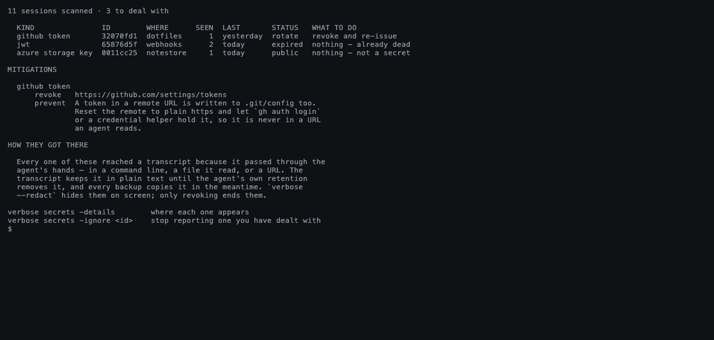

# verbose

[](https://github.com/fooxytv/verbose/actions/workflows/ci.yml)
[](https://github.com/fooxytv/verbose/actions/workflows/release.yml)
[](https://github.com/fooxytv/verbose/releases/latest)
[](go.mod)
[](https://pkg.go.dev/github.com/fooxytv/verbose/pkg/session)
[](LICENSE)

A terminal UI for browsing and analyzing [Claude Code](https://docs.anthropic.com/en/docs/claude-code),
[Codex](https://developers.openai.com/codex/cli),
[GitHub Copilot CLI](https://docs.github.com/copilot/concepts/agents/about-copilot-cli),
[OpenCode](https://opencode.ai) and [pi](https://github.com/badlogic/pi-mono)
session transcripts.

Verbose reads the session data these agents store locally and presents it in a single
interactive, color-coded viewer with real-time updates — and hands any of them
back to its own CLI to carry on.


<sub>Recorded against a synthetic session — see
[docs/demo.tape](docs/demo.tape).</sub>

## What it does

- Reads **Claude Code, Codex, GitHub Copilot CLI, OpenCode and pi** transcripts,
  side by side, across every project on the machine
- **Replays** a session one step at a time at reading speed, typing the code
  out as it was written — for following work that scrolled past in seconds
- Shows the **project tree** marked with what a session changed, and the diff
  of any file beside it
- Says which of a session's work **did not last** (`u`) — the steps whose code
  is no longer in the files
- **Searches** a whole history, or one replay, by what was run, written or
  printed — from the UI or from a prompt with `verbose find`
- Tables the **credentials left in your transcripts** (`verbose secrets`) with
  what to revoke, what is already dead, and what stops each kind getting there
  again — and masks them on screen with `--redact`
- Reconstructs **cost** per model from published rates, per session and per
  project
- Hands any session back to its own CLI to carry on (`c`)
- Follows a **live** session as it is written

## Documentation

The long version of each of these lives in [docs](docs):

| Page | What is in it |
|---|---|
| [Replaying a session](docs/replay.md) | The replay, plans, searching it, what survived, subagents, following a live session |
| [The project tree and diffs](docs/tree.md) | The tree, the diff panel, side-by-side |
| [Finding something again](docs/finding.md) | `verbose find` and searching the history |
| [Secrets in transcripts](docs/secrets.md) | `verbose secrets`, `--redact`, and what neither of them fixes |
| [Working with sessions](docs/sessions.md) | Editors, resuming, renamed folders, deleting |
| [Keybindings](docs/keybindings.md) | Every key, by view |
| [How it works](docs/how-it-works.md) | Where the data comes from |

Implementation notes — the things that cost a bug to learn — are in
[docs/notes](docs/notes).

## What it looks like

**Every session across every project**, by what it is about rather than by id,
whichever agent wrote it: `●` Claude Code, `✦` Codex, `◈` OpenCode, `▪`
Copilot, `▴` pi, and `◦` a subagent run. A subagent sits **under the session that
spawned it**, joined by `├─` and `└─`, so one piece of work reads as one block
instead of rows scattered by timestamp.


**Search every session, not just the titles** (`/`). The list shows what a
session was about; it cannot show what was *in* it, and most of a history is
older than the week you remember. A search reaches prompts, replies, file
paths and commands, says which of those matched each row, and carries the
query into the timeline so the session opens on the hit — and `R` from there
starts the replay on that step rather than at the beginning. There is no
index — scanning 18,000 events takes 12ms, well inside a frame.

**A project is a directory**, and more than one agent can work in it — so the
project view (`p`) marks which ones did, and counts the sessions each
contributed.


**Replay** (`R`) plays a session back at reading speed, typing the code out as
it was written, syntax highlighted. Under the progress bar sits the directory
the work happened in and the branch it was on — `~/workspace/proj  ⎇ main`.


**A plan is rendered, not flattened.** An agent writes markdown, so a `PLAN`
step gets its heading, its table, its numbered list and its `code` and **bold**
laid out — rather than every newline deleted and the whole thing run together
into one paragraph.


**The tree** (`T`) sits beside it and scrolls itself to whatever is being
changed — new files green, changed orange, removed red, untouched dim.


**Diffs** (`d`) open side by side for the file under the cursor, pairing each
removed line against the one that replaced it.


**Your editor** (`e`) opens the selected file at the line that changed, in
whatever `$EDITOR` you already use — here nvim on `handler.go:41`, the hunk the
session had just applied.


**What did not last** (`u`) narrows the replay to the steps whose work is no
longer in the files — three of twenty-one here, one of them written by a
subagent. The line under each headline names the file and says which it is:
something replaced the work, or the file itself is gone.


**Find a step by what it printed** (`/`). The same prompt as "go to step" — a
number jumps, anything else searches — and `n`/`N` move between the matches.
Here `want 404` is in two of the session's twenty-one steps: the test that
asserts it, and the run where it failed. **That failure text exists nowhere but
the step's output**, which is the half of a session no headline can show: one
step in five on this machine ran a command too long to fit on one line.


**And from a prompt.** `verbose secrets` tables the credentials your
transcripts are still holding, by fingerprint — never the value — so the
output is safe to paste into a ticket. The triage is the point: one token to
revoke, one that died three days ago and says so in its own claims, and one
that only looks alarming because it is the emulator key Microsoft publishes.
Each kind carries both halves of the fix — where to revoke it, and what stops
it reaching a transcript again.



**Every source replays the same way.** This is a Codex thread, which records a
new file as content rather than as a diff — so the replay types the whole
document out, and the tree beside it counts the file as new.


Each row keeps its **own** cost, tokens and churn — a parent is not a total of
its children. Summing the column still counts every run exactly once, which is
what the project view relies on.

A subagent whose parent is not in the list — filtered to another project, or
its transcript deleted — stays where it is rather than being hidden, because it
still carries its own cost and its own work.

## Requirements

At least one of:

- **Claude Code** — session transcripts are read from `~/.claude/projects/`
- **Codex** — threads are read from the two SQLite databases under
  `~/.codex` (`$CODEX_HOME` if set): `state_N.sqlite` for the metadata,
  `thread_history_N.sqlite` for the content
- **GitHub Copilot CLI** — sessions are read from `~/.copilot`:
  `session-store.db` for the metadata, `session-state/<id>/events.jsonl` for
  the conversation
- **pi** — one JSONL file per session under `~/.pi/agent/sessions/`
- **OpenCode** — sessions are read from its database, normally
  `~/.local/share/opencode/opencode.db`

## Install

### Download a release (recommended)

Grab the latest pre-built binary for your platform from the
[Releases page](https://github.com/fooxytv/verbose/releases).

Unzip it and move the binary somewhere on your PATH:

**macOS / Linux:**
```bash
sudo mv verbose /usr/local/bin/
```

**Windows:** move `verbose.exe` to a directory on your PATH, or add its location to your PATH.

### With `go install`

Requires Go 1.25+ (the version in `go.mod`).

```bash
go install github.com/fooxytv/verbose@latest
```

**`go install` does not put the binary on your PATH.** It writes to `$GOBIN`, or
`$(go env GOPATH)/bin` when that is unset — usually `~/go/bin`, which macOS and
most Linux distributions do not search. The command succeeds and `verbose` is
still "command not found". Add it once:

```bash
# zsh (the macOS default)
echo 'export PATH="$(go env GOPATH)/bin:$PATH"' >> ~/.zshrc && source ~/.zshrc

# bash
echo 'export PATH="$(go env GOPATH)/bin:$PATH"' >> ~/.bashrc && source ~/.bashrc
```

Check it with `go env GOPATH` and `ls $(go env GOPATH)/bin`: if `verbose` is
there, this is all that was missing.

### From source

Requires Go 1.25+.

```bash
git clone https://github.com/fooxytv/verbose.git
cd verbose
go build -o verbose .
```

## Usage

```bash
verbose                       # the UI
verbose -project myapp        # just one project
verbose --redact              # mask credentials on screen, for sharing it

verbose find "docker run"     # which session ran it, and which step
verbose secrets               # what to revoke, by fingerprint
verbose relink                # repoint a renamed project folder
verbose -json sessions        # machine-readable output
verbose --version
```

Each subcommand takes `-h`. The full `-json` reference, and the flags for
stores in non-standard locations, are in
[How it works](docs/how-it-works.md#json-output).

## License

MIT
